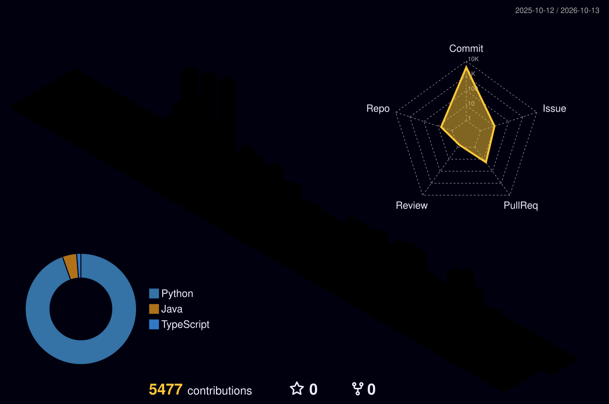

# ☁️ Haneul

<div align="center">
  
</div>

## 🎓 Introduction


<a href="https://git.io/typing-svg">
       
</a>

> 현장에서 막히는 지점을 찾아, 흐름과 정책을 설계해 작동하는 서비스로 만듭니다.

<a href="https://hj0543.github.io">
  
</a>
<a href="https://hj0543.github.io/portfolio/">
  
</a>

---

## 👨‍💻 Developer Profile: `Jeong Hyeonjin`

```python
class Developer:
    def __init__(self):
        self.major = "Materials Engineering"
        self.current = "SSAFY 15th (Samsung Software Academy for Youth)"
```

### 🎖️ Professional Experience

#### **[2026.01 - ing]** SSAFY 15th
> 개발자로서의 첫 걸음

🏆 **수상내역**
* 1학기 성적우수상(1위)
* 특화 프로젝트 우수상(2등) - 도담 팀장·PM, 백엔드, 최종 발표

🎖️ **활동내역**
* Monthly Member(이달의 우수 교육생) 3회 - 1월, 3월, 8월
* 리더를 맡은 프로젝트 3개 - 팀장: 도담·GEOMATE, 프론트엔드 리더: Ait


#### **[2021.07 - 2025.12] Math Academy | Team Leader**
> 학원 현장의 비효율을 코드로 해결
* **Academy Management System:** 구글 스프레드시트 기반 관리/평가 프로그램 기획 및 개발
    * 수기로 적던 진도 기록을 시트의 정형 데이터로 옮겨 진도율 자동 계산
    * 평가 프로그램 기획·개발 및 자동화 OCR 채점 기능 개발
* **Leadership**: 초·중·고 수학 지도, 강사 및 운영팀 관리 (2023.10 - 2025.12)


#### **[2019.03 - 2021.06] ROTC 57th | Army Officer (1st Lt.)**
> 관측·화력운용장교 · 군 조직 내 업무 자동화
* **Non-Fire Training Target Automation:** 비사격 훈련 타겟·일지 작성 자동화 프로그램 개발(Excel) - 🏆근무 유공 표창
* **Targeting simulation:** 적 위치 입력값에 따른 표적 추천 프로그램 개발(Excel) - 🏆근무 유공 표창, 경계작전 유공 표창

---

### 🚀 Projects & Tech Milestones
* **GEOMATE - 도형 조작과 단계형 힌트로 다음 시도를 돕는 기하 학습 앱** (2026.10 - ing)
    * `Role`: 팀장·PM / 프론트엔드 · AI (6인 팀)
    * `Tech Stack`: React, TypeScript, Three.js, Python, FastAPI, SymPy, Gemini API
    * `Result`: 학원 현장 경험과 자체 설문(응답자 92명)으로 '무엇을 시도할지 모름'을 문제로 정의하고, 기하 엔진·단계형 힌트·사진 해석 PoC 구현 (팀 앱 개발 중)

* **도담 - 목표 달성일과 행동별 효과를 비교하는 금융 코치** (2026.08 - 2026.09)
    * `Role`: 팀장·PM / 백엔드 (5인 팀)
    * `Tech Stack`: Java 21, Spring Boot 3.5, Spring Security, JPA, MySQL, Redis, OpenAI API
    * `Result`: 🏆 SSAFY 특화 프로젝트 우수상(2등). 목표 설정→진단→행동 비교→AI 상담→목표별 금액 배정 흐름 설계, 진단·추천·시뮬레이션 엔진과 시계열 소비 예측·세이프박스 구현 (전체 212개 API 중 118개)

* **Ait - AI 모의면접 & 면접 스터디 통합 플랫폼** (2026.07 - 2026.08)
    * `Role`: 프론트엔드 리더 (6인 팀)
    * `Tech Stack`: React, TypeScript, Vite, Tailwind CSS, LiveKit, MediaPipe
    * `Result`: UI 구조를 설계하고 AI 모의면접·실시간 화상 스터디 화면 구현, 면접 진행 상태 5단계와 화면 표시 기준을 문서화해 팀 공통 구현 기준으로 공유

* **Homefit - 개인 맞춤형 부동산 서비스** (2026.05 - 2026.06)
    * `Role`: Full stack (2인 팀)
    * `Tech Stack`: Vue.js, JavaScript, Pinia, Axios, Django REST Framework, FastAPI, Kakao Map API, OpenAI API
    * `Result`: 지도 검색→관심 매물 비교→대출 시뮬레이션 흐름 구현, 공공데이터 수집·전처리·적재와 학군·역세권 비교 기준 설계

* **알고리즘 스터디 디스코드 봇** (2026.02 - 2026.04)
    * `Role`: 1인 기획·개발·배포·운영
    * `Tech Stack`: Python, discord.py, Solved.ac API, Oracle Cloud Infrastructure, GitHub Actions
    * `Result`: 직접 운영한 8인 스터디의 공지 작성·문제 추천·풀이 확인·집계를 명령어와 알림으로 자동화 (백준 서비스 종료로 2026.04 운영 종료)

---

### 📚 Continuous Learning (Licenses)
* `2026.03.06`: **SAMSUNG SW Competency Test - Grade A+ (python)** 🏆
* **정보처리기사** 필기 합격
* **워드프로세서** 2급

---

<div align="center">
  <h1>🛠 Tech Stack</h1>

  

  <h2>Familiar with...</h2>

  <a href="https://skillicons.dev">
    
  </a>

  <h2>Now studying...</h2>

  <a href="https://skillicons.dev">
    
  </a>
</div>

---

<div align="center">

  
</div>

---
## 🌌 My Grass Garden


---

## 🐍 Snake Eating My Contributions
<picture>
  <source media="(prefers-color-scheme: dark)" srcset="https://raw.githubusercontent.com/hj0543/hj0543/output/github-snake-dark.svg">
  
</picture>

---

### 📫 Contact Me
<a href="mailto:hj0543@gmail.com">
  
</a>
<a href="https://hj0543.github.io">
  
</a>
