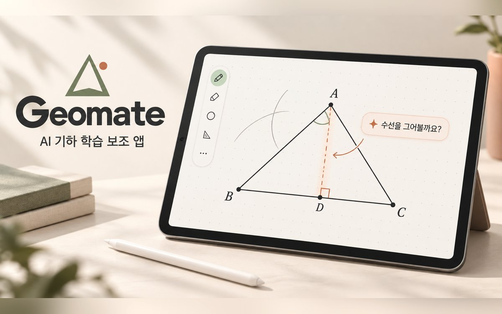
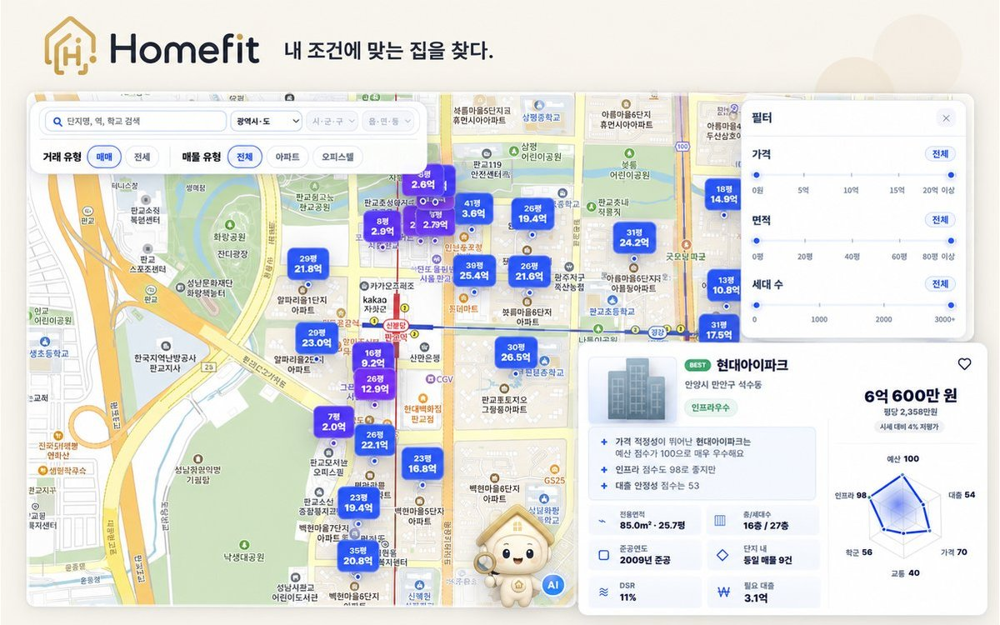
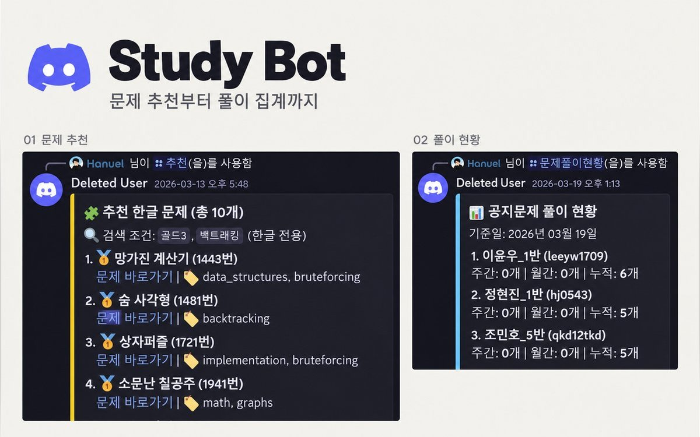
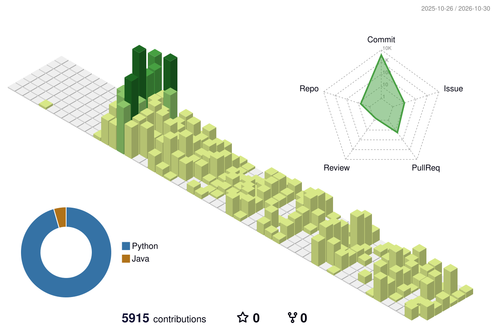

  

  <picture>
    <source media="(prefers-color-scheme: dark)" srcset="https://readme-typing-svg.demolab.com?font=Fira+Code&weight=500&pause=1200&color=A8C5A0&center=true&vCenter=true&width=520&lines=Find+where+users+get+stuck.;Design+the+flow+and+the+policy.;Ship+a+service+that+works.">
    
  </picture>

  
<b>현장에서 막히는 지점을 찾아, 흐름과 정책을 설계해 작동하는 서비스로 만듭니다.</b>

  
  
  

   
  

---

## 🚀 Projects

<table>
  <tr>
    <td width="50%" valign="top">
      
      <h3><a href="https://hj0543.github.io/projects/dodam/">도담</a> 🏆</h3>
      <b>2026.08 – 09 · 팀장·PM / 백엔드 · 5인</b>
      
금융 목표 달성에 필요한 행동을 비교하고 실행하도록 돕는 개인 금융 코치

      
    </td>
    <td width="50%" valign="top">
      
      <h3><a href="https://hj0543.github.io/projects/geomate/">GEOMATE</a></h3>
      <b>2026.10 – 진행 중 · 팀장·PM / FE · AI · 6인</b>
      
도형의 관계를 이해하기 어려운 학생을 위한 기하 학습 서비스

      
    </td>
  </tr>
  <tr>
    <td width="50%" valign="top">
      
      <h3><a href="https://hj0543.github.io/projects/ait/">Ait</a></h3>
      <b>2026.07 – 08 · 프론트엔드 리더 · 6인</b>
      
GitHub 연동을 기반으로 한 AI 면접 훈련 플랫폼

      
    </td>
    <td width="50%" valign="top">
      
      <h3><a href="https://hj0543.github.io/projects/homefit/">Homefit</a></h3>
      <b>2026.05 – 06 · 풀스택 · 2인</b>
      
개인 금융상황·선호도 기반 부동산 추천 서비스

      
    </td>
  </tr>
  <tr>
    <td width="50%" valign="top">
      
      <h3><a href="https://hj0543.github.io/projects/discord-study-bot/">알고리즘 스터디 봇</a></h3>
      <b>2026.02 – 04 · 1인 기획·개발·운영</b>
      
알고리즘 스터디 운영 자동화 디스코드 봇

      
    </td>
    <td width="50%" valign="middle" align="center">
      <h3>📝 더 많은 이야기는 블로그에서</h3>
      
프로젝트별 결정 과정과 회고, 기술 문제 해결 기록을 정리하고 있습니다.

      
    </td>
  </tr>
</table>

SSAFY 프로젝트 소스 코드는 보안서약에 따라 공개하지 않습니다. 자세한 내용은 각 카드의 블로그 페이지에 정리했습니다.

---

## 🎖️ Experience

#### **[2026.01 – ing] SSAFY 15기**
> 개발자로서의 첫 걸음 · 사용자 흐름·서비스 정책 설계, 기능 우선순위와 개발 일정 조율
* 🏆 1학기 성적우수상(1위) · 특화 프로젝트 우수상(2등) - 도담 팀장·PM, 백엔드, 최종 발표
* 🎖️ Monthly Member(이달의 우수 교육생) 3회 - 1월, 3월, 8월
* 👥 리더를 맡은 프로젝트 3개 - 팀장: 도담·GEOMATE, 프론트엔드 리더: Ait

<b>[2021.07 – 2025.12] Math Academy | Team Leader</b> — 학원 현장의 비효율을 코드로 해결

* **Academy Management System:** 구글 스프레드시트 기반 관리/평가 프로그램 기획 및 개발
    * 수기로 적던 진도 기록을 시트의 정형 데이터로 옮겨 진도율 자동 계산
    * 평가 프로그램 기획·개발 및 자동화 OCR 채점 기능 개발
* **Leadership**: 초·중·고 수학 지도, 강사 및 운영팀 관리 (2023.10 – 2025.12)

<b>[2019.03 – 2021.06] ROTC 57th | Army Officer (1st Lt.)</b> — 관측·화력운용장교 · 군 조직 내 업무 자동화

* **Non-Fire Training Target Automation:** 비사격 훈련 타겟·일지 작성 자동화 프로그램 개발(Excel) - 🏆근무 유공 표창
* **Targeting simulation:** 적 위치 입력값에 따른 표적 추천 프로그램 개발(Excel) - 🏆근무 유공 표창, 경계작전 유공 표창

#### 📚 Licenses
* `2026.03.06` **SAMSUNG SW Competency Test - Grade A+ (Python)** 🏆
* **정보처리기사** 필기 합격 · **워드프로세서** 2급

---

## 🛠 Tech Stack

**Familiar with**

<picture>
  <source media="(prefers-color-scheme: dark)" srcset="https://skillicons.dev/icons?i=py%2Cjs%2Cts%2Creact%2Cvue%2Cdjango%2Cmysql%2Chtml%2Ccss%2Cbootstrap%2Cgit&theme=dark">
  
</picture>

**Now studying**

<picture>
  <source media="(prefers-color-scheme: dark)" srcset="https://skillicons.dev/icons?i=java%2Cspring%2Cfastapi%2Cthreejs&theme=dark">
  
</picture>

  

<picture>
  <source media="(prefers-color-scheme: dark)" srcset="https://github-readme-stats-eight-theta.vercel.app/api?username=hj0543&show_icons=true&hide_border=true&bg_color=101D18&title_color=A8C5A0&text_color=DFE8D9&icon_color=A8C5A0">
  
</picture>
<picture>
  <source media="(prefers-color-scheme: dark)" srcset="https://github-readme-stats-eight-theta.vercel.app/api/top-langs/?username=hj0543&layout=compact&hide_border=true&bg_color=101D18&title_color=A8C5A0&text_color=DFE8D9">
  
</picture>

---

## 🌱 Contributions

<picture>
  <source media="(prefers-color-scheme: dark)" srcset="./profile-3d-contrib/profile-night-green.svg">
  
</picture>

<picture>
  <source media="(prefers-color-scheme: dark)" srcset="https://raw.githubusercontent.com/hj0543/hj0543/output/github-snake-dark.svg">
  
</picture>

  

